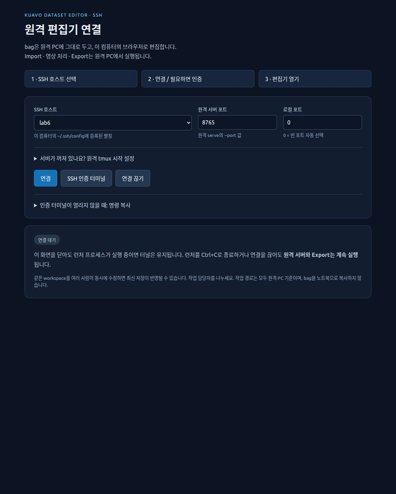
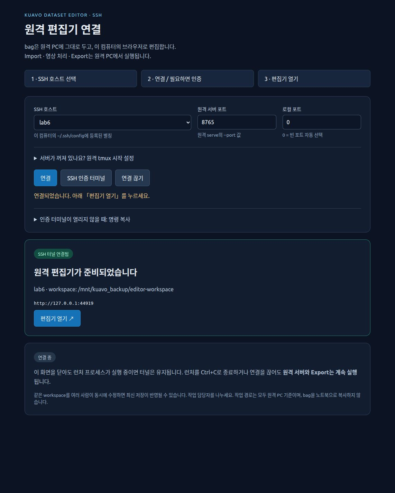
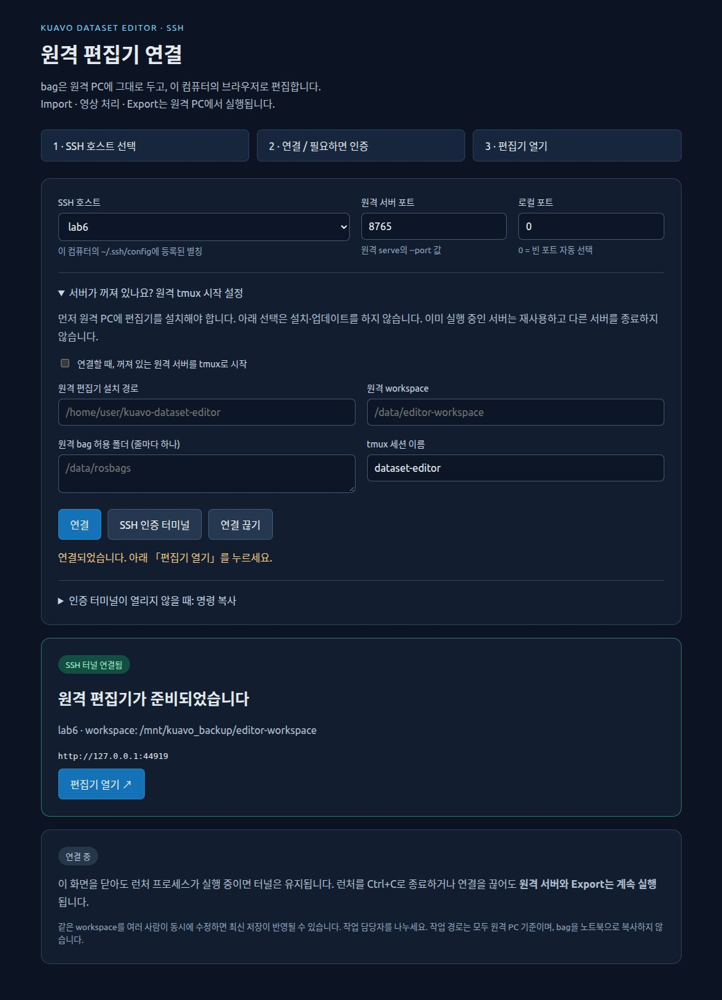

# SSH로 원격 편집기 열기

bag이 있는 PC에서 처리하고, **내 노트북의 브라우저로 편집**하는 연결 화면이다.
bag 다운로드 없이 SSH 터널을 만들고, 빈 로컬 포트를 자동으로 고른다.
이 기능은 Linux x86_64 / ARM64용이며, OpenSSH client가 필요하다.

## 1. 처음 한 번 준비

**서버 PC**에는 편집기와 Export 환경을 설치한다. 이미 설치·실행했다면 반복하지 않는다.

```bash
cd /path/to/kuavo-dataset-editor
bash setup.sh --headless
```

서버에는 tmux가 있어야 아래 자동 시작 기능을 사용할 수 있다. 설치 명령을 자동으로 실행하지 않는다.
시스템 Python·ROS·CUDA를 변경할 필요가 없다. [설치 안내](GETTING_STARTED.md)를 참고한다.

**노트북**에도 이 저장소를 clone하고, 연결 화면을 실행할 최소 환경만 설치한다.
로컬에는 LeRobot·Qt·GPU가 필요 없다. 기존 편집기 환경이 있다면 설치를 반복하지 않는다.

```bash
cd /path/to/kuavo-dataset-editor
bash setup.sh --minimal
```

노트북의 `~/.ssh/config`에 접속 별칭을 등록한다. 아래 주소·계정은 실제 값으로 바꾼다.
설정 파일은 개인 PC에서 관리하고 Git에 넣지 않는다.

```sshconfig
Host robot-up
    HostName <SERVER_IP>
    User <SERVER_USER>
```

이미 `ssh robot-up`처럼 접속한다면 그 별칭을 그대로 사용한다. 키/ssh-agent뿐 아니라
일반 SSH 비밀번호 인증도 지원한다. 비밀번호는 SSH 터미널에서만 입력하고 편집기에 저장하지 않는다.
다른 팀원도 **각자 PC의 SSH 설정과 접근 권한**을 사용한다. 인증정보를 공유할 필요는 없다.

## 2. 노트북에서 실행하고 연결

```bash
bash remote.sh
# 호스트를 미리 선택하려면:
bash remote.sh --host robot-up
```

`bash run.sh remote`도 동일하다. 터미널에 출력되는 `Remote editor launcher: http://127.0.0.1:...`가
**연결 화면** 주소이며 브라우저가 자동으로 열린다. 자동으로 열리지 않으면 주소를 직접 연다.



1. **SSH 호스트**를 선택한다. 목록은 노트북의 기존 SSH 설정에서 읽는다.
2. **원격 서버 포트**에 서버의 `serve --port` 값(기본 `8765`)을 넣는다.
3. **로컬 포트**는 `0`으로 둔다. 이미 쓰는 포트를 피해서 자동으로 연다.
4. **연결**을 누른다. 키 인증이 되면 바로 연결된다.
5. 인증이 필요하면 **SSH 인증 터미널**을 누른다. 열린 터미널에서 호스트 키를 확인하고
   비밀번호/키 암호를 입력한 뒤, 연결 화면에서 **연결**을 다시 누른다.
   호스트 키가 예상과 다르면 진행하지 말고 관리자에게 확인한다.
6. **편집기 열기** 버튼(↗)을 누른다. 새 탭에서 원격 편집기를 사용할 수 있다.



이미지는 실제 접속 예시다. 호스트·workspace·포트는 각 환경마다 다르다.
**연결 화면 주소와 편집기 주소는 서로 다른 포트**다. 두 주소 모두 내 노트북의 `127.0.0.1`이다.
인증 터미널과 런처 프로세스는 사용 중 열어 둔다. 인증 터미널에 출력 없이 대기하는 것은 정상이다.

터미널 창이 자동으로 열리지 않는 환경에서는 **인증 터미널이 열리지 않을 때: 명령 복사**를 펼쳐
표시된 명령을 **노트북의 터미널**에서 실행한다. 인증 후 연결을 다시 누른다.
이 명령의 임시 소켓 경로는 런처 실행마다 달라지므로 문서나 SSH 설정에 고정해서 저장하지 않는다.

## 3. 원격 서버가 꺼져 있다면

연결 화면에서 **서버가 꺼져 있나요? 원격 tmux 시작 설정**을 펼친다.
**연결할 때, 꺼져 있는 원격 서버를 tmux로 시작**을 체크하고 아래 값을 채운 뒤 연결한다.



| 항목 | 예시 | 의미 |
| --- | --- | --- |
| 원격 편집기 설치 경로 | `/home/user/kuavo-dataset-editor` | 서버의 `run.sh`가 있는 폴더 |
| 원격 workspace | `/data/editor-workspace` | 기존 annotation을 이어서 쓸 작업 폴더 |
| 원격 bag 허용 폴더 | `/data/rosbags` | 브라우저에서 선택할 원본 폴더. 여러 개면 줄마다 하나 |
| tmux 세션 이름 | `dataset-editor` | 서버가 꺼졌을 때 새로 만들 세션 이름 |

모든 경로는 **원격 PC 기준**이다. 기존 annotation을 이어서 사용하려면 기존 workspace를 정확히 넣는다.
이 옵션은 원격 `python3`와 `tmux`, 설치된 `bash run.sh serve`만 사용한다.
자동 설치·업데이트·기존 서버 종료는 하지 않는다. 설정은 런처/페이지가 살아 있는 동안만 유지된다.

- 같은 포트·workspace의 서버가 이미 켜져 있으면 그대로 재사용한다.
- 다른 workspace 서버나 다른 서비스가 포트를 쓰면 종료하지 않고 오류를 안내한다.
- 같은 이름의 tmux 세션만 있고 서버가 없으면 기존 세션을 덮어쓰지 않는다. 로그를 확인하거나 새 세션 이름을 쓴다.
- 서버가 준비되지 않으면 `ssh robot-up` 후 `tmux attach -t dataset-editor`로 로그를 확인한다.
  tmux에서 나올 때 `Ctrl+B`, 이어서 `D`를 누르면 서버를 종료하지 않고 분리한다.

수동 실행도 가능하다. [기존 SSH 터널 안내](VISUAL_GUIDE.md#다른-pc의-브라우저에서-사용하기-ssh-터널)에
서버 명령과 런처 없이 접속하는 방법이 있다.

## 4. 편집과 종료

편집기에서는 `파일·폴더에서 선택…`으로 서버의 bag을 고른다.
`SSH에서 불러오기…`는 다른 PC의 bag을 내려받는 별도 기능이므로 이 연결에는 필요 없다.
Import/cache/annotation/Export 결과는 모두 원격 PC에 남는다. 노트북에는 bag/workspace를 만들지 않는다.
영상 미리보기에는 네트워크 전송과 브라우저 메모리가 사용되므로 완전한 무전송 방식은 아니다.

**연결 끊기** 또는 런처 터미널의 `Ctrl+C`는 이 런처가 만든 SSH 연결만 종료한다.
**원격 편집기와 Export는 계속 실행된다.** 원격 서버를 끄는 버튼은 제공하지 않는다.
노트북 절전·네트워크 단절 후에는 다시 연결하고 원격 작업 목록을 확인한다.

다른 팀원도 자기 노트북에서 같은 흐름으로 연결하면 된다. 각자 로컬 포트는 자동 선택되므로
포트를 맞출 필요가 없다. 단, 이 기능은 사용자별 잠금/공동 편집 기능이 아니다.
**같은 프로젝트를 동시에 수정하지 말고** 프로젝트 담당자를 나누거나 서로 다른 workspace를 사용한다.

## 문제 해결과 안전한 연결

| 증상 | 확인할 내용 |
| --- | --- |
| 호스트 목록이 비어 있음 | 노트북 `~/.ssh/config`의 구체적인 `Host` 별칭을 추가하고 새로고침. `Host *`는 선택 항목이 아님 |
| 인증 후에도 연결 안 됨 | 인증 터미널을 유지하고 연결을 다시 누르기. 일반 `ssh 별칭` 접속, 네트워크/VPN/ProxyJump 확인 |
| 편집기에 연결하지 못함 | 서버가 켜져 있는지, 원격 포트가 맞는지 확인. 필요하면 tmux 시작 옵션 사용 |
| 로컬 포트 사용 중 | 로컬 포트를 `0`으로 변경 |
| 연결됐지만 원본 파일이 없음 | 서버 workspace와 `--allow-root` 확인. 노트북 폴더를 보고 있는 것이 아님 |
| 연결 끊기 후 화면이 멈춤 | 정상. 원격 작업은 계속되며 새로 연결한 편집기 주소에서 확인 |

서버와 런처는 모두 **`127.0.0.1`에만 바인딩**한다. 편집기에는 별도 로그인 기능이 없으므로
`--host 0.0.0.0`, 공유기 포트 개방, 인증 없는 외부 공개를 사용하지 않는다.
localhost도 같은 PC의 신뢰된 사용자만 쓰는 환경을 전제로 한다.
새 연결은 기존 개인 SSH master와 구분된 임시 소켓을 사용하며, 종료 시 다른 SSH 세션은 끊지 않는다.
비밀번호·개인키·SSH 설정은 프로젝트/annotation/Git에 복사하지 않는다.
