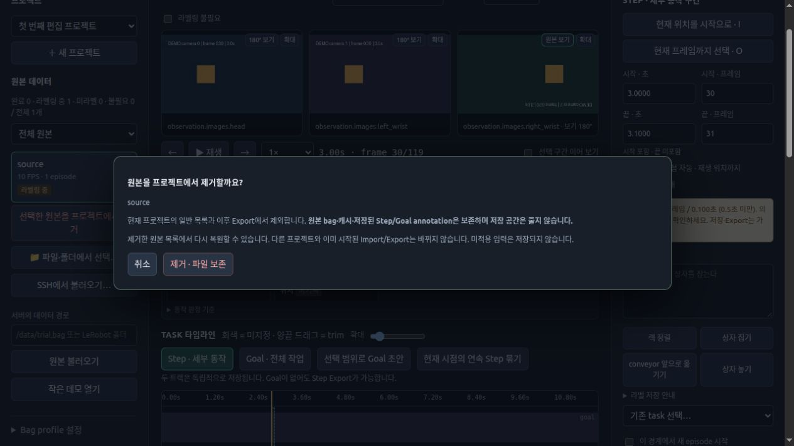
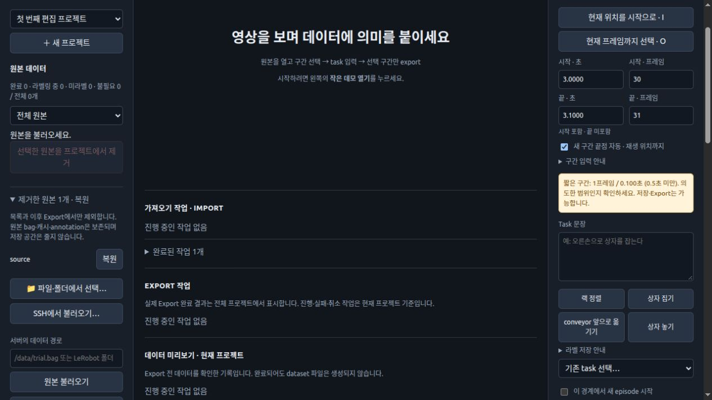

# 원본별 라벨링 상태

## 원본을 프로젝트에서 제거·복원하기

왼쪽 원본 목록에서 bag을 선택한 뒤 **선택한 원본을 프로젝트에서 제거**를 누른다.
확인창에서 승인하면 일반 목록과 이후 Export/데이터 미리보기에서 제외된다.

다시 사용하려면 왼쪽 **제거한 원본 N개 · 복원**을 펼쳐 해당 파일의 **복원**을 누른다.
마지막 원본까지 제거해 영상 화면이 닫혀도 이 목록은 남는다. 새로고침·서버 재시작 후에도 복원할 수 있다.

이 기능은 **복원 가능한 프로젝트 내 보관**이다. 원본 등록 정보와 저장된 Step·Goal·제외 구간,
완료·불필요 표시·학습 split은 그대로 남는다. 원본 bag, 다운로드 파일, 영상 캐시는 삭제하지 않는다.
따라서 **제거만으로 저장 공간이 확보되지는 않는다.** 다른 프로젝트·되돌리기·진행 중인 Export가
같은 파일을 참조할 수 있어 캐시 자동 삭제와는 분리한다. 복원 시 재다운로드나 재추출하지 않는다.
저장 공간 관리는 [저장 공간 가이드](STORAGE.md)를 참고한다.

제거 상태(`source_removed`)는 **현재 프로젝트에만** 저장하며, 연결된 다른 프로젝트에 전파하지 않는다.
연결된 프로젝트에서 같은 bag의 라벨을 고치면 제거된 동안에도 공유 라벨은 갱신되므로,
복원할 때 동료의 최신 라벨을 오래된 사본으로 덮어쓰지 않는다. 일반 되돌리기/다시 실행도 지원한다.
미적용 입력은 annotation으로 저장되지 않으므로 적용하거나 확인창의 안내를 읽고 제거한다.

이미 시작된 Export는 시작 당시 snapshot으로 계속되며, 이미 Export된 dataset의 episode를
소급 삭제하지 않는다. 제거 상태를 반영하려면 새 Export를 시작한다. 기존 dataset 수정 모드는
기존 결과를 교체하는 기능이므로 확인창의 범위를 별도로 확인한다.

최신 서버와 화면을 함께 사용한다. 실행 중인 서버가 구형이면 제거 버튼은 비활성화된다.
제거 기능을 모르는 옛 버전(예: `ver1.1` 태그)으로 되돌리면 보관된 원본이 다시 보일 수 있으므로,
해당 버전에서 그대로 Export하지 말고 최신 버전을 사용한다.

## 라벨링 상태 표시

왼쪽 원본 목록에 **미라벨 / 라벨링 중 / 라벨링 완료 / 라벨링 불필요**를 표시한다.

- 미라벨: 해당 원본에 저장된 Step·Goal·공통 제외 구간이 없고 완료로 표시하지 않은 상태.
- 라벨링 중: 해당 원본에 저장된 Step·Goal 또는 공통 제외 구간이 있지만 완료로 표시하지 않은 상태.
- 라벨링 완료: 영상 위쪽 **라벨링 완료**를 사람이 직접 체크한 상태. 해당 프로젝트의 원본 전체(모든 episode)에 적용한다.
- 라벨링 불필요: task를 시작하지 않은 bag 등 영상 위쪽 **라벨링 불필요**를 사람이 직접 체크한 상태. 미라벨·라벨링 중·미완료 목록에서 빠지고 별도 필터에 표시한다.

완료와 불필요는 동시에 체크할 수 없다. 불필요를 해제하면 저장된 라벨·제외 구간 유무에 따라 미라벨 또는 라벨링 중으로 돌아간다.
불필요 표시는 직접 해제할 때까지 유지한다. 저장된 라벨과 원본은 보존하며 새 생성·추가·수정 Export 및 데이터 미리보기에서
해당 원본의 Step·Goal 구간을 자동 제외한다. 프로젝트 전체 라벨을 선택해도 적용된다.
다시 내보내려면 불필요 표시를 해제한다. 이미 완성된 dataset에서 과거에 저장한 episode를 소급해서 삭제하지는 않는다.

빈 구간은 버릴 데이터일 수도 있으므로 라벨 비율이나 Export 성공만으로 완료를 자동 판정하지 않는다.
Step만 사용하는 작업도 완료로 표시할 수 있다. 이 체크는 입력 중인 문장을 저장하거나 Export를 실행하지 않는다.
라벨·경계·Goal·제외 구간을 수정하면 해당 원본의 완료가 자동 해제된다. 학습 split 변경은 완료를 해제하지 않는다.

목록 위에 상태별 개수와 **전체 원본 / 미완료 원본 / 완료 원본 / 라벨링 중 원본 / 미라벨 원본 / 라벨링 불필요 원본** 필터가 있다.
미완료 원본은 라벨링 중과 미라벨을 함께 보여주며, 각각의 필터에서는 해당 상태만 보여준다.
필터는 목록 표시만 바꾸며 현재 선택한 영상·입력 중인 구간·Export 대상에는 영향을 주지 않는다.

완료 여부는 원본 등록 정보를 바꾸지 않고 프로젝트의 `source_completed`에, 불필요 여부는 `source_not_required`에 저장한다.
SQLite revision·Undo/Redo·프로젝트 JSON에도 보존하며 기존 프로젝트는 완료 표시 없이 시작한다.
별도 프로젝트의 같은 bag에는 기본적으로 따로 표시한다. `annotation_group`으로 명시적으로 연결한
날짜별·전체 프로젝트는 같은 원본 ID의 Step·Goal·제외 구간, 완료·불필요 표시와 학습 split을 공유한다.
저장 시 해당 bag의 변경만 연결된 프로젝트에 한 SQLite transaction으로 반영하고 각 프로젝트의
revision을 남긴다. 다른 원본의 라벨과 프로젝트별 Export 설정은 유지한다. 일반 테스트 프로젝트는
연결하지 않는다. 원본 ID의 fingerprint·FPS·episode 길이가 다르면 저장 전체를 취소한다.

연결된 다른 창의 변경은 재생·저장·드래그·확인 창이 끝난 뒤 자동 반영한다. 입력 중인 문장·구간과
재생 위치는 초안으로 유지하고 이전 Undo/Redo 목록은 비워 다른 창의 변경을 덮어쓰지 않는다.
반영 전에 오래된 revision으로 저장하면 기존과 같이 충돌을 알리고 새로고침을 요구한다.
Undo/Redo로 저장된 라벨을 되돌리는 작업도 연결된 프로젝트에 반영된다.
진행 중인 import와 원본 bag·영상 cache는 변경하지 않는다.
