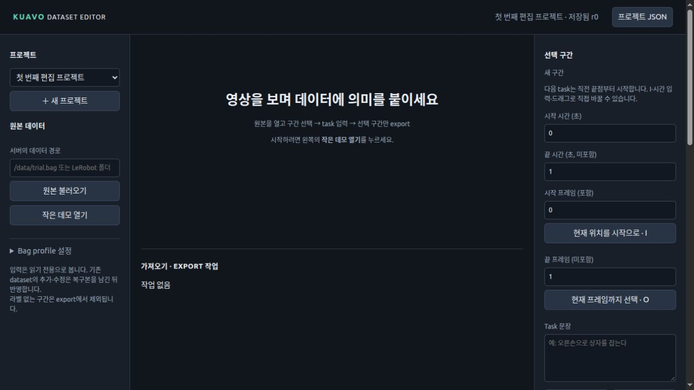
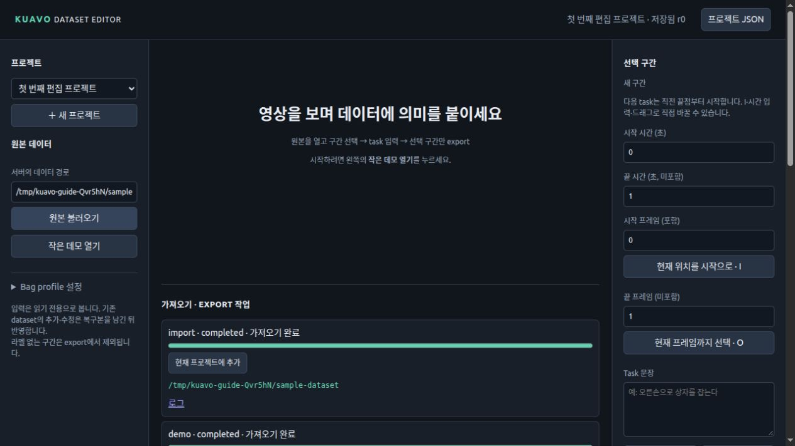
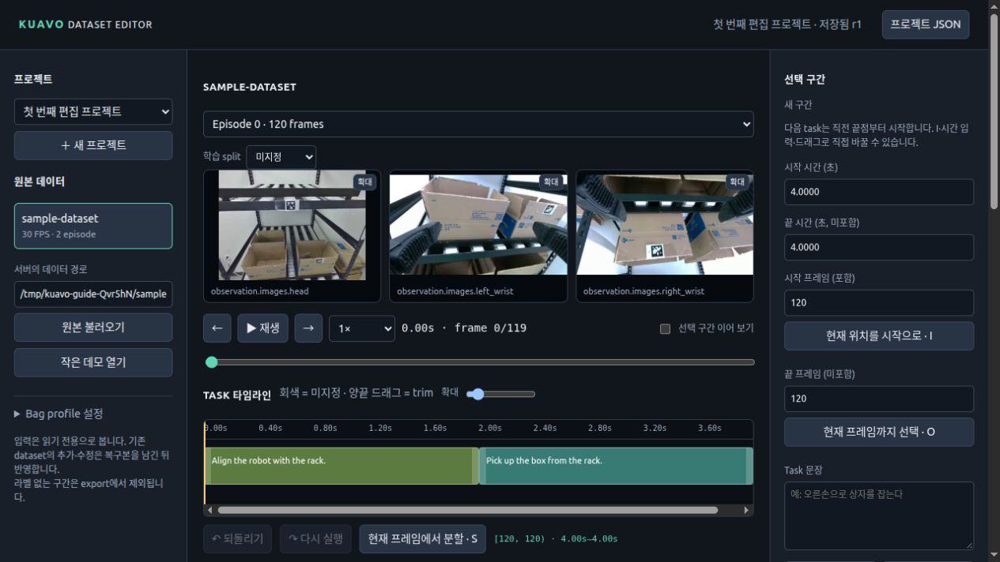
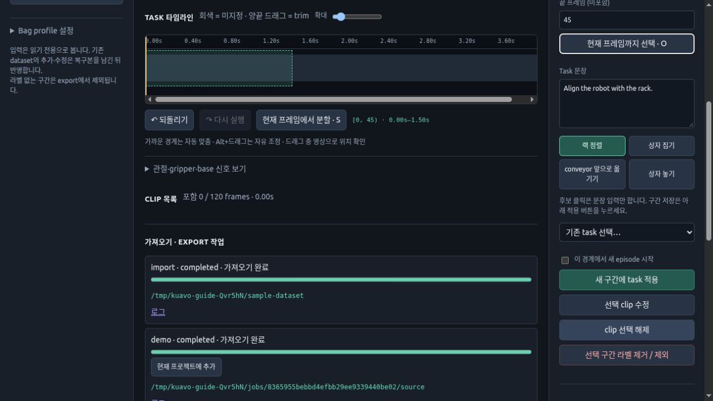
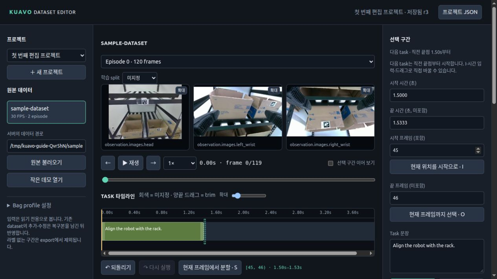
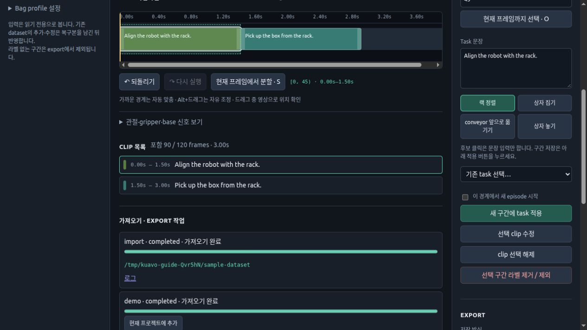
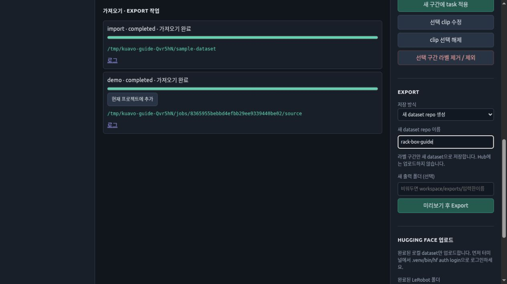
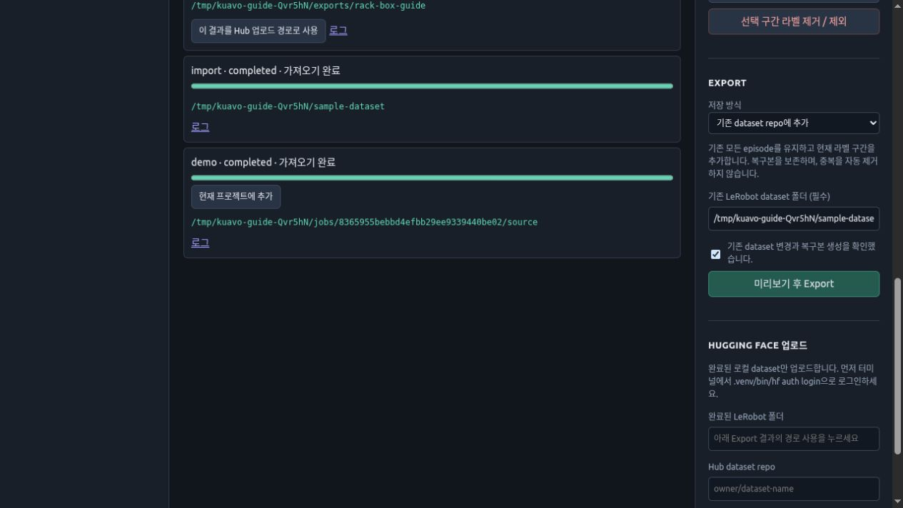
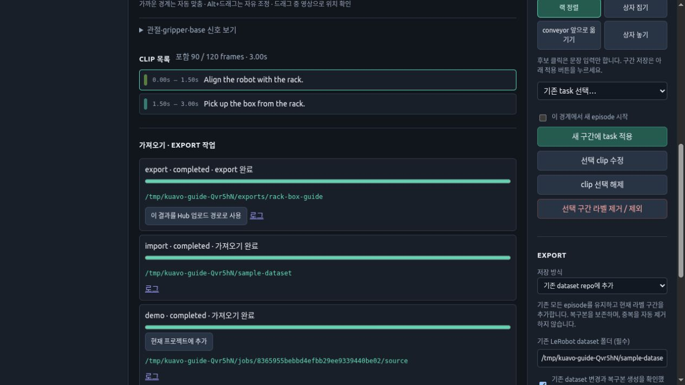
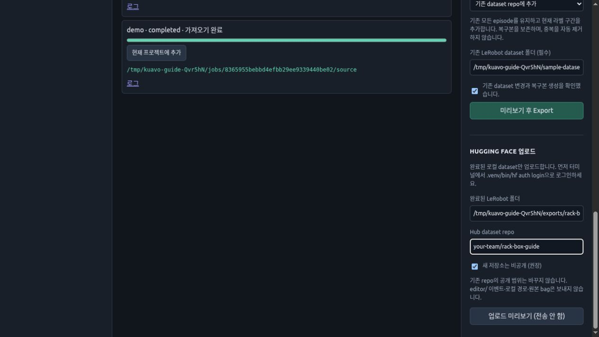

# 화면으로 따라 하는 데이터셋 편집

설치가 끝났다면 아래 순서로 진행한다. 명령과 OS 준비는 [새 PC 설치·실행](GETTING_STARTED.md)을 참고한다.

이 가이드의 사진은 **실행 중인 편집기의 실제 화면**이다. 영상 화면은 팀에서 공개를 허용한
실험 영상의 8초짜리 검증용 LeRobot 사본을 사용했다. 원본 bag·기존 라벨 프로젝트는 수정하지 않았다.
task 문장과 구간은 기능 설명용 예시이며, 영상 동작의 의미나 성공 여부를 검증한 정답 라벨이 아니다.
그림의 시간은 잘라 만든 사본 기준이므로 원래 bag의 시각과 다르다.

사진은 웹 모드의 공통 편집 화면이다. 데스크톱 앱도 같은 버튼을 사용하며,
추가로 상단의 **Bag 선택 / LeRobot 폴더 선택 / 출력 경로 선택**에서 파일 선택창을 사용할 수 있다.
그림 속 `/tmp/...`와 dataset 이름은 예시이므로 자신의 경로와 이름으로 바꾼다.
번호는 문서에만 표시되는 안내이며, 실제 앱에는 이 번호가 없다. 사진을 클릭하면 원본 크기로 볼 수 있다.

## 다른 PC의 브라우저에서 사용하기: SSH 터널

큰 bag을 노트북으로 다운로드하지 않고, **bag이 있는 PC에서 편집기 서버를 실행**한 뒤
**노트북의 브라우저로 조작**할 수 있다. ROS master, Quest 연결, 서버 PC의 그래픽 화면은 필요하지 않다.

- **서버 PC**: bag 읽기, import/cache 생성, 편집 저장, 지원 환경에서의 Export를 수행한다.
- **노트북**: SSH 터널과 브라우저만 사용한다. 영상 프레임과 편집 정보를 주고받으며 bag 전체를 받지 않는다.
- 프로젝트·cache·Export 결과는 서버 PC에 남는다. 같은 workspace로 다시 실행하면 이어서 작업할 수 있다.
  영상 응답 속도는 네트워크와 서버의 처리 성능에 영향을 받는다.

### A. 서버 PC에서 환경 준비

저장소 접근 권한이 있는 계정으로 clone한다. 이미 설치했다면 clone과 설치를 반복하지 않는다.

```bash
git clone https://github.com/robots-oh/kuavo-dataset-editor.git
cd kuavo-dataset-editor
```

**Linux x86_64 또는 ARM64(aarch64)**에서 아래처럼 설치한다. 아키텍처에 맞는 CPU 환경을
자동 선택하며 Qt 데스크톱 앱 없이 웹 편집·Export 환경을 준비한다.

```bash
bash setup.sh --headless
```

로봇 PC에서는 이 가이드를 위해 시스템 Python, ROS, CUDA/JetPack을 변경하지 않는다.
`sudo apt install/upgrade/autoremove`를 무조건 실행하지 말고, OS 의존성이 부족한 경우
변경할 패키지를 먼저 확인한다. 환경 구성의 세부 사항은 [새 PC 설치·실행](GETTING_STARTED.md)을 참고한다.

**이전 ARM64 임시 환경에서 Export가 안 됐다면:** 최신 소스로 갱신한 뒤 위의
`bash setup.sh --headless`를 실행한다. 기존 `.venv`를 삭제하지 않고 별도 환경에 LeRobot을 설치한다.
annotation이 저장된 workspace는 바꾸지 않는다. 설치 성공 후 같은 workspace로 편집기 서버만
재시작한다. `bash run.sh doctor --export`로 결과를 확인할 수 있다.

### B. 서버 PC에서 웹 서버 실행

저장소 폴더에서 실행한다. 아래는 Up PC의 경로 예시이며 실제 데이터 위치로 바꾼다.

```bash
env -u PYTHONPATH -u LEROBOT_SOURCE bash run.sh serve \
  --workspace /home/leju_kuavo/kuavo_dataset/editor-workspace \
  --allow-root /home/leju_kuavo/kuavo_dataset/rosbags \
  --host 127.0.0.1 \
  --port 8765
```

`PYTHONPATH`와 `LEROBOT_SOURCE`는 이 명령에서만 제외해 ROS나 별도 LeRobot checkout의
Python 경로가 섞이지 않게 한다. 다른 ROS 터미널의 환경은 바꾸지 않는다.

`Uvicorn running on http://127.0.0.1:8765`가 나오면 서버가 열린 것이다.
이 터미널을 유지한다. 종료는 `Ctrl+C`이며, SSH 세션이 끊기면 서버도 종료될 수 있다.
다음에 실행할 때는 설치를 반복하지 않고 같은 workspace로 이 서버 명령을 실행한다.

### C. 노트북에서 SSH 터널 연결

**서버 PC 안이 아니라 노트북의 새 터미널**에서 실행한다.
`leju_kuavo`는 서버 계정, `<BAG_PC_IP>`는 실제 서버 IP로 바꾼다.

```bash
ssh -N -L 127.0.0.1:8767:127.0.0.1:8765 leju_kuavo@<BAG_PC_IP>
```

기존 SSH 설정의 별칭이 있다면 `leju_kuavo@<BAG_PC_IP>` 대신 그 별칭을 쓴다.
연결 후 출력 없이 대기하는 것이 정상이다. 터널 터미널도 유지하고,
노트북 브라우저에서 [http://127.0.0.1:8767](http://127.0.0.1:8767)을 연다.
노트북의 8767 포트가 사용 중이면 터널 명령의 `8767`과 브라우저 주소의 포트를 함께 바꾼다.

서버는 `127.0.0.1`에만 열고 SSH로 전달한다. 편집기에는 별도 사용자 로그인 기능이 없으므로
`--host 0.0.0.0`으로 인증 없이 외부에 공개하거나 공유기 포트를 개방하지 않는다.
현재 별도 데스크톱 앱에는 원격 서버 연결 메뉴가 없으므로 이 구성에서는 브라우저를 사용한다.

### D. 브라우저에서 서버 PC의 bag 선택

1. **＋ 새 프로젝트**로 만들거나 기존 프로젝트를 선택한다.
2. **파일·폴더에서 선택…**을 누른다. 보이는 폴더는 노트북이 아니라 **서버 PC의 폴더**다.
3. 여러 bag을 체크하고 **선택한 N개 사용**을 누른다. 여기까지는 파일 선택만 한 상태다.
4. 왼쪽의 선택된 파일 목록을 확인한 뒤 **원본 불러오기**를 누른다.
5. 작업 목록의 `import-batch` 또는 `import` 진행 상태를 확인한다.
   완료되면 **현재 프로젝트에 추가**를 눌러 영상과 타임라인을 연다.

이 구성에서는 **SSH에서 불러오기…를 사용하지 않는다.** 그 기능은 다른 서버의 bag을
편집기 실행 PC로 다운로드할 때 쓰는 별도 기능이다.

선택 후에도 **작업 없음**이면 4번까지 눌렀는지 확인한다. 눌렀는데 그대로라면
화면의 오류 알림과 [작업 상태 JSON](http://127.0.0.1:8767/api/jobs)을 확인한다.
`[]`이면 해당 서버에 등록된 작업이 없는 상태다. 이 로컬 주소는 SSH 터널이 켜져 있어야 열린다.

## 1. 프로젝트와 원본 불러오기

최신 버전에는 **파일·폴더에서 선택…**과 **SSH에서 불러오기…** 버튼이 추가되었다.
[새 파일 선택·SSH 가이드](DATA_IMPORT.md)에서 경로 입력 없이 고르는 방법을 먼저 확인할 수 있다.
아래 기존 화면의 경로 입력 방식도 계속 지원한다.



1. **＋ 새 프로젝트**를 눌러 작업 이름을 정한다. 자동 생성된 첫 프로젝트를 써도 된다.
2. **서버의 데이터 경로**에 `.bag` 파일 또는 LeRobot 루트 폴더를 입력한다.
   데스크톱에서는 상단 파일 선택창으로 경로를 채울 수 있다. 파일 선택만으로는 import되지 않는다.
3. **원본 불러오기**를 누른다. 긴 bag은 기다리는 동안 아래 작업 목록에서 진행 상태를 본다.
4. 데이터 없이 먼저 연습하려면 **작은 데모 열기**를 사용한다.

여러 bag은 파일 선택창에서 함께 선택하거나 이 과정을 반복해 같은 프로젝트에 추가한다.
파일 선택 후에는 **원본 불러오기**를 별도로 눌러야 한다. 경로는 브라우저가 아닌 편집기 서버 PC 기준이다.
외부 폴더의 접근 오류는 `--allow-root` 설정 또는 데스크톱 파일 선택으로 해결한다.

## 2. 완료된 import를 프로젝트에 추가



1. **import · completed · 가져오기 완료**를 확인하고 **현재 프로젝트에 추가**를 누른다.

여기까지 해야 카메라 영상과 타임라인이 열린다. 완료 표시만 보고 멈추지 않는다.
bag은 처음에는 task가 비어 있다. 기존 LeRobot을 열면 원래 task 구간도 함께 가져온다.

## 3. 영상을 보며 시점 찾기



1. **원본 episode**에서 편집할 episode를 선택한다. 여러 원본은 왼쪽 원본 목록에서 전환한다.
2. **▶ 재생** 또는 `Space`로 재생·정지한다. `←/→`는 0.5초씩, `Shift+←/→` 또는 화면 좌우 버튼은 한 프레임씩 이동한다.
3. 영상 아래 탐색 막대를 클릭하거나 끌어 원하는 시점으로 이동한다. 카메라들은 같은 프레임 기준이다.
4. **Task 타임라인**의 색 구간은 지정된 task다. 회색 부분은 라벨이 없어 Export에서 빠진다.

그림은 기존 라벨이 있는 LeRobot을 연 상태다. 다음 실습에서는 설명용 사본의 첫 episode 라벨을
제거하고 새 구간을 지정했다. 자기 데이터의 기존 라벨을 보존하려면 그대로 clip을 선택해 수정한다.

## 4. 구간에 task 적용



1. 새 구간은 **끝점 자동 · 재생 위치까지**가 기본이다. 영상을 원하는 시점까지 보고 멈추면
   현재 프레임까지 선택된다. 끝점을 고정하려면 **현재 프레임까지 선택 · O**를 누르거나
   **끝 프레임** 또는 **끝 시간**에 값을 입력한다. 시작점을 바꾸려면 `I` 또는 시작 입력란을 쓴다.
2. **랙 정렬 / 상자 집기 / conveyor 앞으로 옮기기 / 상자 놓기** 중 후보를 클릭한다.
   **상자 집기**를 누르면 **중간 선반 · 왼쪽/오른쪽, 상단 선반 · 왼쪽/오른쪽**이 펼쳐진다.
   집을 상자 위치를 고르면 영어 문장이 입력된다. 좌우는 **랙 정면을 바라본 기준**이며 상단은 top 선반이다.
   예: `Pick up the box from the left side of the middle shelf of the rack.`
3. **Task 문장**에 들어간 영어 instruction을 확인한다. 필요하면 직접 수정한다.
4. **새 구간에 task 적용**을 눌러 저장한다. 후보 클릭만으로는 구간이 저장되지 않는다.
   기존 라벨을 바꾸려면 clip 선택 → 위치 선택 → **선택 clip 수정**을 누른다. 예전 라벨은 자동 변환하지 않는다.

예시는 30 FPS에서 `[0, 45)` = 0.00–1.50초 구간이다. 시작 프레임은 포함하고 끝 프레임은 포함하지 않는다.
`O`는 현재 보이는 프레임을 포함하도록 끝을 현재 프레임+1로 정한다.

## 5. 다음 task는 직전 끝에서 이어서

전체 작업도 함께 학습하려면 위쪽 **Goal 트랙**을 사용한다. 여러 Step의 시작/끝을 선택하고
**선택 범위로 Goal 초안** 또는 **현재 시점의 연속 Step 묶기** → 문장·범위 확인 → **새 Goal에 적용** 순서다.
두 트랙의 바를 클릭하면 각각 편집할 수 있으며 기존 Step은 덮어쓰지 않는다.
오른쪽 **학습용 instruction 트랙**에서 Step/Goal을 선택한 뒤 미리보기·Export한다.
[Goal 트랙 상세 사용법과 포함/제외 규칙](GOAL_ANNOTATIONS.md)을 참고한다.



1. 첫 구간을 적용하면 **시작 시간**이 직전 끝점으로 자동 이동한다. 그림에서는 1.50초다.
2. 영상을 다음 종료점까지 보고 다음 후보를 선택한 뒤 **새 구간에 task 적용**을 누른다.
   자동 끝점이 켜져 있으면 `O`를 매번 누를 필요가 없다. 수동 입력·O·범위 드래그 후에는 끝점이 고정되며,
   체크박스를 다시 켜면 자동으로 돌아간다. 기존 clip을 선택했을 때는 재생만으로 범위가 바뀌지 않는다.

시작점을 매번 다시 입력할 필요가 없다. 건너뛸 부분이 있으면 `I`·시간 입력·타임라인 드래그로
직접 시작점을 옮긴다. 미지정 빈 구간은 자동으로 앞 task에 포함되지 않는다.
episode 끝에 도달하면 다른 episode 또는 원본을 선택한다.

아직 다음 시작점 이후로 이동하지 않았다면 대기 범위다. 임시 1프레임을 저장하지 않는다.
**0.5초 미만** 구간은 선택 영역·저장 목록·Export 확인에 경고하지만 저장과 Export는 허용한다.
기존 짧은 구간을 자동으로 늘리거나 지우지 않는다. 목록의 **짧음** 표시를 눌러 영상을 보고 수정한다.
서로 맞닿은 동일 Step task는 하나로 합쳐 표시·저장하며 합친 길이로 경고한다.
빈 구간·새 episode·사용자의 명시적 분할·별도 Goal 경계는 유지한다.
기존 설명 이미지는 이전 UI이므로 새 체크박스와 경고가 표시되지 않을 수 있다.

## 6. 경계 수정·분할·제외



먼저 타임라인의 clip 또는 아래 **Clip 목록**에서 수정할 구간을 클릭한다.

1. clip **양끝 손잡이**를 끌어 길이를 바꾼다. 놓으면 변경이 저장된다.
   가까운 경계에는 스냅하고, 멀면 새 위치를 지정한다. `Alt`를 누르면 스냅을 해제한다.
   드래그하는 동안 영상도 해당 시점으로 바뀐다.
2. 구간 내부로 재생 위치를 옮기고 **현재 프레임에서 분할 · S**로 나눈다.
   커서·점선 선택 범위도 가까운 기존 clip과 데이터 제외 구간의 시작·끝에 맞춰진다. 경계에 맞춘 끝점은
   한 프레임을 더 포함하지 않는다. 경계 근처를 분할하려면 `Alt`를 누르고 이동하거나
   `Shift+←/→`로 한 프레임씩 이동한다. 자동 재생과 숫자 입력에는 스냅을 적용하지 않는다.
3. 숫자 입력이나 task 문장을 바꿨다면 **선택 clip 수정**을 눌러 반영한다.
4. 버릴 부분을 범위로 선택하고 **선택 구간 라벨 제거 / 제외**를 누른다. 원본 파일을 지우는 기능은 아니다.

**새 구간에 task 적용**과 **선택 clip 수정**은 다르다. 기존 clip 변경에는 후자를 사용한다.
실수했다면 **↶ 되돌리기** 또는 `Ctrl+Z`를 쓴다.

## 7. 새 이름으로 로컬 Export

SSH 다운로드를 노트북/SSD로 받을 때는 [로컬 실행·SSD 저장·빠른 SSH 가져오기](DATA_IMPORT.md#노트북-로컬-실행-외장-ssd)를 참고한다.
업데이트된 데스크톱 앱은 상단 **SSH 저장 폴더…**, SSH 선택창은 **받은 bag 저장 폴더 / 전송 방식**을 제공한다.



**Export 대상**의 기본값은 **현재 선택한 원본만**이다. 왼쪽에서 선택한 bag의 모든 episode 중 라벨 구간을 사용한다.
날짜/수집 batch를 한 번에 처리하려면 **프로젝트 전체 라벨**로 바꾼다. 오른쪽에 대상 원본을 표시하며,
미리보기와 실제 Export에 같은 범위를 적용한다. 라벨링 완료 체크와 목록 필터는 Export 대상을 바꾸지 않는다.

1. **저장 방식 → 새 dataset repo 생성**을 선택한다.
2. **새 dataset repo 이름**에 `rack-box-v1` 같은 이름을 입력한다. 로컬 이름이며 Hub repo를 만들지 않는다.
3. **새 출력 폴더**를 정한다. 비우면 `workspace/exports/입력한이름`에 저장한다.
4. **데이터 미리보기 (저장 안 함)**로 state/action·validity·누락 사유를 확인할 수 있다.
   영상 아래 **원본 bag / Export 데이터 확인**에서 Raw 토픽 메시지도 조회할 수 있다.
   [검사 패널 사용법](DATA_INSPECTION.md)을 참고한다. 이미지 예시의 이전 `미리보기 후 Export` 버튼은 현재 **설정 확인 후 Export**다.
5. **설정 확인 후 Export**를 누르고 최종 frame/episode 수와 경로를 확인한 뒤 진행한다.

필수 상태값이나 카메라 누락이 있으면 인코딩을 시작하기 전에 **Export 전 누락 구간 확인** 창이 열린다.
bag·센서별로 끊긴 프레임 수, 구간, 앞뒤 원본 메시지의 시간 간격을 확인한다.
단 1프레임 누락이어도 앞뒤 기록 간격은 더 길 수 있다. 현재 bag profile은 수신 시각 기준이다.

- 상태값은 앞뒤 값 사이의 선형 보간, 명령값은 이전 명령 유지, 영상은 이전 실제 프레임 재사용을 선택할 수 있다.
- 기본값은 모두 **처리 방법 선택…**이다. **보정 가능한 구간 모두 선택**도 사용자의 명시적인 선택이며,
  보정 불가능한 구간은 별도로 제외 여부를 정해야 한다. bag 시작/끝 밖으로 값을 외삽하거나 다른 bag에서 가져오지 않는다.
- 제외하면 그 시간의 모든 센서를 함께 제외하며 episode가 분리될 수 있다. 최종 미리보기에서 수를 확인한다.
- 취소하면 Export를 시작하지 않는다. 원본 bag·cache·annotation은 보정/제외 선택으로 변경하지 않는다.
- 결과의 `editor/quality.json`과 `editor/frame_mapping.parquet`에서 보정 내역을 확인할 수 있다.

점검은 캐시의 필수 수치값과 카메라 프레임 매핑을 확인하며 전체 영상을 재디코딩하는 검사는 아니다.
이미 LeRobot으로 인코딩된 원본은 수치값을 점검한다. 파일 손상이나 영상 디코딩 오류는 별도로 확인해야 한다.

**프로젝트 전체 라벨**을 선택하면 여러 원본의 라벨 구간을 함께 Export한다. 미지정 구간과 원본/episode 경계는
유지되므로 영상들을 하나의 끊김 없는 episode로 무조건 합치지 않는다.
새 출력 경로는 비어 있어야 한다. 기존 결과에 추가하려면 아래 모드를 사용한다.

## 8. 기존 dataset에 추가하거나 수정하기



1. **기존 dataset repo에 추가** 또는 **기존 dataset repo 수정**을 선택한다.
2. **기존 LeRobot dataset 폴더**를 지정한다.
3. 변경 및 복구본 생성을 읽고 체크한다.
4. **미리보기 후 Export**에서 내용을 확인하고 실행한다.

- **추가**: 기존 모든 episode를 유지하고 위에서 선택한 대상의 새 구간을 더한다.
  이미 대상 dataset에 저장된 원본 프레임은 건너뛰고 확인 창에 개수를 표시한다. 전부 저장된 구간이면 작업을 시작하지 않는다.
  같은 bag의 아직 저장되지 않은 구간은 추가할 수 있다. 기존 라벨을 바꾸려면 추가 대신 수정 모드를 사용한다.
- **수정**: 먼저 수정할 기존 dataset을 프로젝트에 불러온다. 라벨·구간을 편집한 후
  현재 프로젝트의 지정 구간만 남긴 결과로 교체한다. 의도하지 않은 다른 원본도 포함되어 있지 않은지 확인한다.
  이 모드는 프로젝트 전체 결과를 교체하므로 현재 원본만 선택하는 옵션을 사용하지 않는다.
- 둘 다 기존 폴더를 복구본으로 남긴다. 백업 경로는 완료 작업에 표시된다.

사진은 설정 예시다. 가이드 캡처를 위해 실제 원본 dataset에 추가·교체를 실행하지는 않았다.
세부 규칙은 [로컬 dataset 관리](DATASET_REPOSITORIES.md)를 참고한다.

## 9. 완료 결과 확인



1. 작업 목록의 **export · completed · export 완료**를 확인한다. `running`은 아직 처리 중이다.
2. 표시된 경로가 학습에 사용할 완성된 LeRobot 폴더다. 프로젝트 JSON이나 bag 경로와 구분한다.
3. 공유가 필요할 때만 **이 결과를 Hub 업로드 경로로 사용**을 누른다.

완료 Export는 프로젝트와 관계없이 게시 시각이 최근인 순서로 표시한다. 각 카드에서 원본 이름,
작업 시작/결과 게시 시각, 이번에 추가한 수량과 완료 후 합계를 구분한다.
같은 경로에 여러 번 추가했다면 **현재 폴더 결과**가 그 경로의 최신 결과다.
**이전 Export 기록**의 수량은 과거 작업 당시 기준이며, 같은 공통 경로를 열면 현재 최신 결과가 보인다.

업데이트 후 새 Export는 episode별 checkpoint를 저장한다. 실패/취소되면 작업 목록의
**완료 episode부터 이어가기**를 눌러 완료 영상을 재사용하고 중단 episode부터 다시 처리한다.
그 작업 시작 당시의 annotation/누락 처리 선택으로 재개하며, 현재 편집 내용은 변경하지 않는다.
구 버전 job은 checkpoint가 없어 새 Export가 필요하다.
[재개·잠금 처리 상세](DATASET_REPOSITORIES.md#export-속도와-episode-단위-이어가기)

그림의 로컬 Export는 별도 설명용 workspace에서 실제로 완료했다. 로컬 Export만 사용해도 된다.
오류가 나면 **로그**에서 원인을 확인한다. 완성되지 않은 `.partial` 폴더를 최종 데이터로 쓰지 않는다.

## 10. Hugging Face 공유는 선택



먼저 같은 PC의 터미널에서 `"$(dirname "$(bash run.sh --print-python)")/hf" auth login`으로 로그인한다.
UI에 token을 입력하지 않는다.

1. **완료된 LeRobot 폴더**가 맞는지 확인한다.
2. **Hub dataset repo**에 본인 또는 조직의 실제 `owner/dataset-name`을 입력한다.
   그림의 `your-team/rack-box-guide`는 예시다.
3. 새 repo는 **비공개**가 기본값이다. 기존 repo는 실제 원격 공개 범위를 유지한다.
4. **업로드 미리보기**(전송 안 함)를 누른다. 생성된 작업에서 전송·삭제·공개 범위를 확인하고,
   이후 별도의 **실제 업로드** 확인을 해야 전송한다.

사진은 입력 화면까지다. 촬영 과정에서 Hub 로그인·repo 생성·실제 데이터 업로드는 하지 않았다.
원격 append가 아니라 완성된 로컬 snapshot 동기화이며, `editor/` sidecar는 기본 제외한다.
자세한 절차는 [Hugging Face 가이드](HUGGING_FACE.md)를 참고한다.
